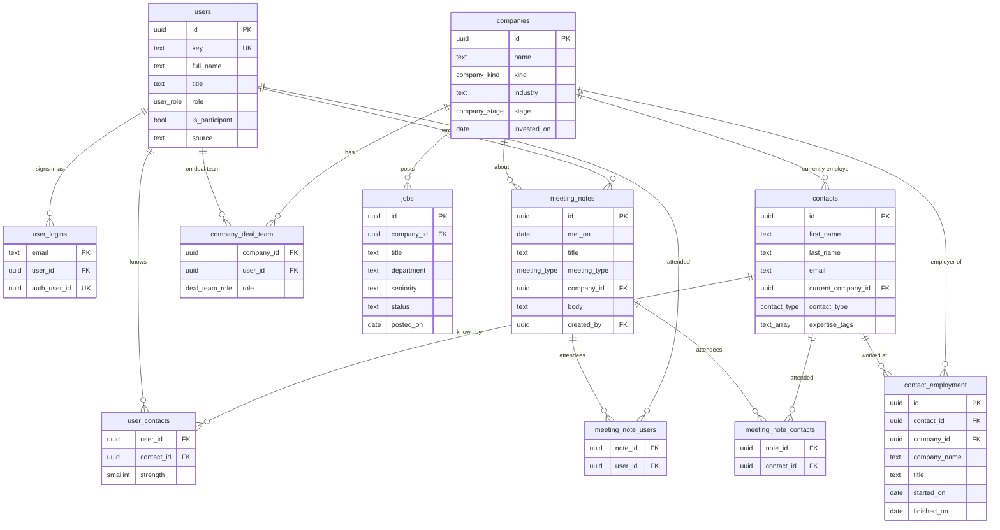

# 🧇 Stroopwafel Ventures

A starter app for the **AI Build Lab, Group 2: Matching & Warm Introductions** (Amsterdam).

Stroopwafel Ventures is a **fictional** Amsterdam early-stage VC fund. The app holds its portfolio,
its network of contacts, who on the team knows whom (and how well), open jobs, and Granola-style
meeting notes where portfolio needs come up. Sub-teams extend it to answer questions like:

> *"Which of our contacts is the best fit for this need, and who on our team should make the intro?"*

**All companies, people and notes are fictional.** The only real data is the participant list,
which stays in a git-ignored local file and never enters this public repo.

---

## Contents

- [Stack](#stack)
- [Setup](#setup)
- [Deploy](#deploy)
- [Adding people](#adding-people)
- [How to add a feature](#how-to-add-a-feature)
- [Integrations](#integrations)
- [Data model](#data-model)
- [Seed data](#seed-data)

## Stack

- **Next.js 16** (App Router, TypeScript, server components) + **Tailwind v4**
- **Supabase**: Postgres, passwordless Auth, RLS, `pgvector`
- **@anthropic-ai/sdk** for Claude; thin wrappers for Perplexity, Reverse Contact, Harmonic and Voyage
- **Vercel** for hosting, deployed from this public repo

> Note: Next.js 16 renamed `middleware.ts` to `proxy.ts`, and `params`/`searchParams`/`cookies()` are async.
> Version-matched docs live in `node_modules/next/dist/docs/`.

## Setup

### 1. Supabase project

1. Create a project at [supabase.com](https://supabase.com).
2. **Schema:** open *SQL Editor*, paste [`supabase/migrations/0001_init.sql`](supabase/migrations/0001_init.sql) and run it
   (or `supabase link` + `supabase db push`). This enables `pgvector`, creates every table, and turns on RLS.
3. **Disable public sign-ups:** *Authentication → Sign In / Providers →* turn **off** "Allow new users to sign up".
   Keep the **Email** provider on. Only people pre-created by the seed script or the admin page can sign in.
   (The login form also passes `shouldCreateUser: false` as a second lock.)
4. **Custom SMTP (required):** Supabase's built-in sender allows only a few emails per hour, which isn't enough for 16+ people
   logging in at once.
   - Create a [Resend](https://resend.com) account, verify a sending domain, and create an API key.
   - In *Authentication → Emails → SMTP Settings*: host `smtp.resend.com`, port `465`, user `resend`,
     password = your Resend API key, sender e.g. `noreply@yourdomain.com`.
   - In *Authentication → Rate Limits*, raise "emails sent per hour" (e.g. 100).
5. **Email template (link + 6-digit code):** in *Authentication → Emails → Templates → Magic Link*, paste
   [`supabase/templates/magic_link.html`](supabase/templates/magic_link.html). It includes `{{ .Token }}` (the code)
   and a `token_hash` link that works even when opened in a different browser.
6. **Redirect URLs:** in *Authentication → URL Configuration*:
   - Site URL: your Vercel production URL, e.g. `https://stroopwafel-ventures.vercel.app`
   - Redirect URLs: add
     - `https://stroopwafel-ventures.vercel.app/**`
     - `https://*-<your-vercel-team>.vercel.app/**` (preview deployments)
     - `http://localhost:3000/**`

### 2. Environment variables

```bash
cp .env.example .env.local
```

Fill in the Supabase URL, anon key and service-role key (*Project Settings → API*), plus `ADMIN_EMAILS`.
Every other key is optional: integrations without a key run in **mock mode**.
Only the two `NEXT_PUBLIC_` values reach the browser. **Never** prefix anything else with `NEXT_PUBLIC_`.

### 3. Participants (local only)

Put the real list in `seed/participants.local.json`. It's git-ignored, and a pre-commit hook
(`npm run check:privacy`) blocks any commit that contains a participant's name or email.

```json
[
  { "key": "p01", "full_name": "…", "title": "Platform Partner", "role": "admin", "email": "…" },
  { "key": "p11", "full_name": "…", "title": "VP Talent & Platform", "role": "talent", "emails": ["…", "…"] }
]
```

Without the local file, the seed uses [`seed/participants.example.json`](seed/participants.example.json) (fictional people at `@example.com`).
Entries with no usable email (e.g. a `REPLACE_WITH_…` placeholder) are created but can't sign in until an email is added.

### 4. Install, seed, run

```bash
npm install          # also installs the privacy pre-commit hook
npm run seed         # upserts participants + logins, then loads seed/data/*.json
npm run dev          # http://localhost:3000
```

`npm run seed` is safe to re-run at any time. It wipes and reloads companies, contacts, jobs,
relationships and notes, but **never deletes people or logins** (admin-added people survive).

**Optional: run Supabase locally** (needs Docker): `npx supabase start` uses `supabase/config.toml`
(sign-ups off, magic-link template) and applies the migration. Put the printed API URL, anon key and
service-role key in `.env.local`, then `npm run seed`. Login emails land in Mailpit at http://127.0.0.1:54324.

Fixtures are committed, so seeding never calls an API. To regenerate them:

```bash
npm run generate                 # uses Claude for prose if ANTHROPIC_API_KEY is set, templates otherwise
npm run generate -- --offline    # deterministic templates only
npm run validate:fixtures        # counts, foreign keys, golden scenarios, privacy
```

## Deploy

### No-laptop setup (Vercel only)

You don't need to run anything locally:

1. Run the schema in Supabase's SQL editor and configure Auth (steps 1–6 of [Setup](#setup)).
2. In Vercel, add the env vars, plus **`PARTICIPANTS_JSON`**: the contents of `seed/participants.local.json`
   as one line of JSON. It lives only in Vercel, never in git.
3. Deploy, then sign in with an admin email from that list. The login form creates the account on the fly
   for any email on `PARTICIPANTS_JSON` (and only those).
4. Go to **/admin → Re-seed data**. It adds everyone on the list, then loads all the fixtures.

To add someone later, use `/admin/people`, or add them to `PARTICIPANTS_JSON` and redeploy.

### Steps

1. Push this repo to GitHub (public).
2. In Vercel: *Add New → Project →* import the repo. Framework preset: Next.js.
3. Add the env vars from `.env.example` for **Production** and **Preview**.
4. Every push to `main` auto-deploys to production; branches get preview URLs.
5. Add the production URL to Supabase's Site URL and redirect URLs (above).

Seeding runs from your laptop against the production Supabase (`npm run seed` with production keys in `.env.local`),
or from the app at **/admin → Re-seed data** (participants from `PARTICIPANTS_JSON`, then all fixtures).

## Adding people

Every path calls the same idempotent server function, `addParticipant()` in [`lib/participants.ts`](lib/participants.ts).
It upserts the `users` row, creates confirmed auth users for any new emails, and links them in `user_logins`.

| Where | How |
|---|---|
| **App** (admins) | `/admin/people`: add one person, bulk-paste a list (with preview), add or remove emails, give someone a 🧇 starter network of ~30 contacts |
| **CLI** | `npm run add-user -- --name "Jane Doe" --email jane@x.com --email alt@y.com --title "Platform Lead" --role platform` |
| **CLI, bulk** | `npm run add-users -- list.txt` |
| **File** | edit `seed/participants.local.json`, then `npm run seed` |

The CLI also appends the person to `seed/participants.local.json` with the next free key (`p18`, …).
Bulk formats, one per line: `Name <email>`, `email`, or `Name, Title, role, email[, email]`.
Roles: `investment`, `platform`, `talent`, `community`, `partnerships`, `operations`, `admin`.

Admins are anyone in `ADMIN_EMAILS` or with role `admin`.

## How to add a feature

1. **Read data** in a server component with `const supabase = await createClient()` from `lib/supabase/server.ts`.
   RLS lets any signed-in team member read everything.
2. **Add a page**: create `app/(app)/your-page/page.tsx`. The `(app)` layout handles auth and the sidebar.
   Add a link in `components/Sidebar.tsx`.
3. **Call Claude**: copy `app/api/ai/example/route.ts`.
   - Prompts go in `lib/prompts/` (a Zod schema, a system prompt, a prompt builder).
   - Call `claudeJson()` (structured output) or `claudeStream()` (streamed text) from `lib/integrations/anthropic.ts`.
   - Start every route with `guardApi()` (auth + per-user rate limit) and set `export const maxDuration`.
4. **Schema changes**: add `supabase/migrations/0002_your_change.sql`, run it in the SQL editor, and update
   `lib/types.ts`, `lib/fixtures.ts` and `docs/SEED_PROMPT.md` if the shape changes.
5. **Matching ideas**: `seed/GOLDEN_SCENARIOS.md` lists planted matches to test against. Full-text search works out of the box
   (`contacts.search`, `meeting_notes.search`); `npm run embed` adds Voyage vectors for semantic search.

Before pushing: `npm run typecheck && npm run lint && npm run check:privacy`.

## Integrations

All live in `lib/integrations/`. Each one is server-only, exposes one typed function, and returns realistic fake data
(`mocked: true`) when its key is missing, so local and preview builds work without keys.

| Wrapper | Function | Good for | Key |
|---|---|---|---|
| `anthropic.ts` | `claudeJson()`, `claudeStream()` | Reasoning over our data, ranking warm paths, summarising notes, drafting intros | `ANTHROPIC_API_KEY` |
| `perplexity.ts` | `searchWeb(query)` | Fresh public info about a company (funding, news, launches) | `PERPLEXITY_API_KEY` |
| `reverseContact.ts` | `enrichEmail(email)` | Public profile behind an email a participant knowingly provided | `REVERSE_CONTACT_API_KEY` |
| `harmonic.ts` | `lookupCompany(domain)` | Headcount, funding, investors, growth signals for a company | `HARMONIC_API_KEY` |
| `voyage.ts` | `embed(texts)` | Embeddings for semantic matching (`npm run embed`) | `VOYAGE_API_KEY` |

> ⚠️ **Real-data caution.** Perplexity, Reverse Contact and Harmonic return data about real people and companies.
> Use them only on public company information or on data participants knowingly provide.
> Never write their results about real individuals into seed fixtures.

The example: `/ai-example` (page) → `POST /api/ai/example { contact_id }` → `{ summary, best_connector_user_id, reasoning }`,
plus `POST /api/ai/draft-intro`, which streams an intro-request draft.

## Data model



Also: `embeddings` (`entity_type`, `entity_id`, `content`, `vector(1024)`) and `rate_limits`.
Relationship strength runs 1 (barely know) to 5 (very close; shown as **Gezellig**).
`contact_employment.finished_on = null` means a current role. Two contacts who overlapped at the same `company_id`
are a backchannel path even when nobody on the team knows the target directly.

## Seed data

| File | What |
|---|---|
| `seed/data/*.json` | Committed fictional fixtures with stable UUIDs (see `lib/fixtures.ts` for the shape) |
| `seed/GOLDEN_SCENARIOS.md` | Planted matches: a need, the best contact, a strong warm path, and a decoy |
| `seed/participants.example.json` | Fictional participant list with the same shape as the local file |
| `docs/SEED_PROMPT.md` | Paste-into-Claude prompts to recreate a similar fictional world |
| `docs/LINKEDIN_MAPPING.md` | How LinkedIn exports map onto `contacts` / `contact_employment` |

Fixtures refer to team members only by key (`p04`, `i02`). In note bodies, names appear as `{{user:p04}}`
and are swapped for real names at seed time, so names never enter git.
